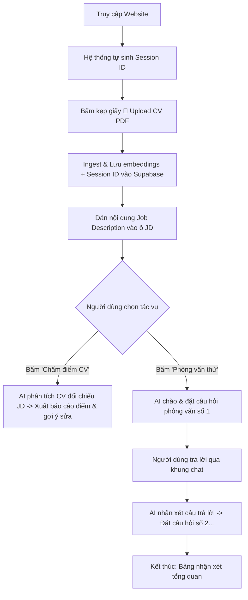

# PRD: AI Resume Matcher & Interview Coach

## 1. Giới thiệu & Mục tiêu (Overview & Goals)
- **Tên dự án:** AI Resume Matcher & Interview Coach (Trợ lý Chấm điểm CV & Phỏng vấn Kỹ thuật)
- **Bối cảnh:** Sinh viên IT mới tốt nghiệp / Fresher thường gặp khó khăn trong việc đánh giá mức độ tương thích giữa CV của mình và Job Description (JD) của nhà tuyển dụng, đồng thời thiếu kỹ năng trả lời phỏng vấn kỹ thuật thực chiến.
- **Mục tiêu sản phẩm:** 
  - Cung cấp công cụ phân tích CV đối chiếu với JD, chấm điểm % phù hợp và chỉ ra kỹ năng thiếu sót kèm gợi ý hành động cụ thể.
  - Cung cấp chế độ phỏng vấn kỹ thuật giả lập (Mock Interview) theo vòng hội thoại tương tác (multi-turn), đặt câu hỏi chuyên sâu xoáy vào đúng dự án trong CV và nhận xét câu trả lời từng lượt.

---

## 2. Đối tượng sử dụng (Target Users)
1. **Sinh viên CNTT / Lập trình viên Fresher**: Muốn hoàn thiện CV trước khi ứng tuyển vào các công ty công nghệ (Enclave, Netcompany, CodeGym, FPT, v.v.) và luyện tập phản xạ phỏng vấn.
2. **Technical Mentors / Giảng viên đào tạo**: Dùng làm công cụ hỗ trợ review hồ sơ và tổ chức phỏng vấn thử cho học viên.
3. **Người chuyển ngành (Career Switchers)**: Cần biết CV hiện tại thiếu các từ khóa kỹ thuật nào so với yêu cầu tuyển dụng thực tế.

---

## 3. Tính năng cốt lõi (Core Features)

### 3.1. Quản lý CV theo Phiên (Session-Isolated Resume Ingestion)
- Tải lên 1 hoặc nhiều file PDF CV (tối đa 5 file, mỗi file < 10MB).
- Mỗi phiên làm việc (mỗi tab trình duyệt) được cấp một `sessionId` ngẫu nhiên lưu trong `localStorage`/memory.
- Khi Ingest PDF, `sessionId` được lưu vào `metadata` của từng chunk trong vector database (Supabase).
- Khi truy vấn (RAG), hệ thống lọc chính xác các chunk có `metadata.sessionId == currentSessionId` để đảm bảo không lẫn lộn dữ liệu giữa các phiên người dùng.

### 3.2. Nhập & Quản lý Job Description (JD Input)
- Giao diện có khu vực riêng (Panel / Accordion) cho phép người dùng dán (paste) nội dung văn bản JD tuyển dụng.
- Cung cấp nút lưu tạm JD vào trạng thái giao diện và đếm số từ.
- Có thể xóa/thay đổi JD bất cứ lúc nào.

### 3.3. Chế độ 1: Chấm điểm CV & So khớp JD (Match & Review Mode)
- **Kích hoạt:** Bấm nút **"🎯 Chấm điểm CV với JD"** trên giao diện.
- **Luồng xử lý:** 
  - AI đọc toàn bộ nội dung CV trong phiên hiện tại và đối chiếu với JD.
  - Phân tích và trả về phản hồi theo cấu trúc Markdown rõ ràng:
    1. **Điểm phù hợp tổng quan (Match Score)**: Tỷ lệ % ước tính kèm tóm tắt lý do.
    2. **Kỹ năng & Yêu cầu đáp ứng tốt (Matching Skills)**: Các điểm mạnh CV đã có.
    3. **Lỗ hổng & Kỹ năng còn thiếu (Missing Keywords/Gaps)**: Các công nghệ, kinh nghiệm trong JD mà CV chưa thể hiện.
    4. **Gợi ý viết lại Action-Oriented (Actionable Enhancements)**: Đề xuất viết lại 2–3 gạch đầu dòng trong CV bằng **tiếng Anh chuyên nghiệp** (áp dụng công thức *Action Verb + Context + Measurable Result*).

### 3.4. Chế độ 2: Phỏng vấn Thử giả lập (Interactive Mock Interview Mode)
- **Kích hoạt:** Bấm nút **"🎙️ Bắt đầu Phỏng vấn Thử"**.
- **Luồng xử lý multi-turn (Hội thoại từng lượt):**
  - AI đóng vai **Senior Technical Lead / Hiring Manager** tại công ty tuyển dụng theo JD.
  - AI đọc các dự án, công nghệ trong CV và đưa ra lời chào cùng **DUY NHẤT 1 câu hỏi kỹ thuật chuyên sâu** (xoáy vào kiến trúc, giải pháp, hoặc quyết định kỹ thuật của dự án đã làm).
  - Người dùng gõ câu trả lời vào khung chat.
  - AI đánh giá câu trả lời của ứng viên (điểm tốt, điểm chưa sâu/cần bổ sung), sau đó mới chuyển sang câu hỏi tiếp theo (tổng cộng 3-5 câu hỏi trong 1 phiên phỏng vấn).
  - Kết thúc buổi phỏng vấn, AI đưa ra bảng đánh giá chung (Strengths, Weaknesses, Final Recommendation).

### 3.5. Trải nghiệm Giao diện & Hiển thị (UI/UX)
- Khung chat hỗ trợ render **Markdown** đầy đủ (in đậm, danh sách gạch đầu dòng, khối code, bảng biểu) thông qua thư viện `react-markdown`.
- Có thanh trạng thái hiển thị rõ: CV đã tải lên (tên file, số trang), JD đã nhập (độ dài), và chế độ đang chạy.

---

## 4. Luồng hoạt động người dùng (User Journey & Flow)

---

## 5. Tiêu chuẩn Hoàn thành & Ranh giới Phạm vi (Scope & DoD)
- **Phạm vi làm:**
  - Cách ly theo session trên Supabase bằng `metadata.sessionId`.
  - Nâng cấp UI Next.js: JD Panel + 2 Action Buttons + Markdown chat render.
  - Thiết kế System Prompts chuyên biệt cho Chấm điểm và Phỏng vấn.
  - Tăng $k$ retrieval lên 20 để phủ trọn vẹn CV.
- **Phạm vi KHÔNG làm ở giai đoạn này:**
  - Không làm hệ thống đăng nhập tài khoản (Auth) người dùng.
  - Không làm lưu trữ lịch sử nhiều phiên phỏng vấn vào SQL riêng (chỉ lưu trong phiên LangGraph thread hiện tại).
  - Không sinh file PDF xuất ngược ra ngoài (chỉ hiển thị trực tiếp trên giao diện).
